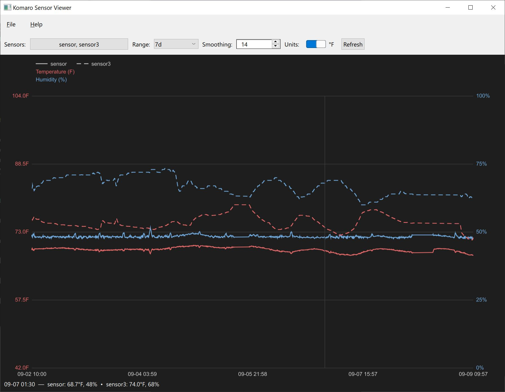
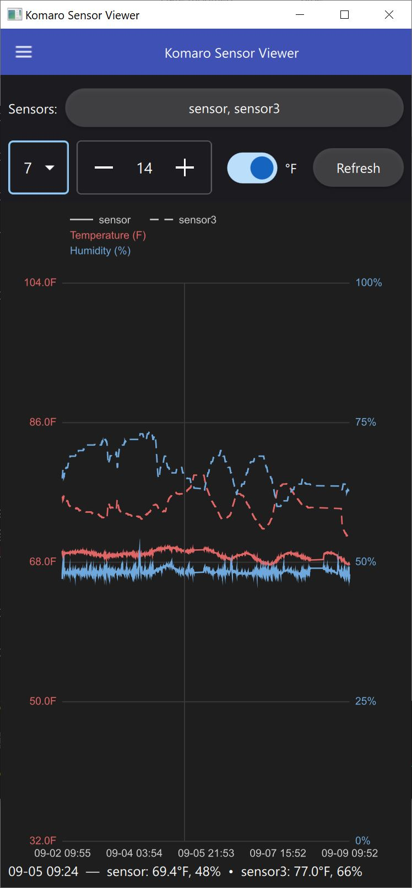
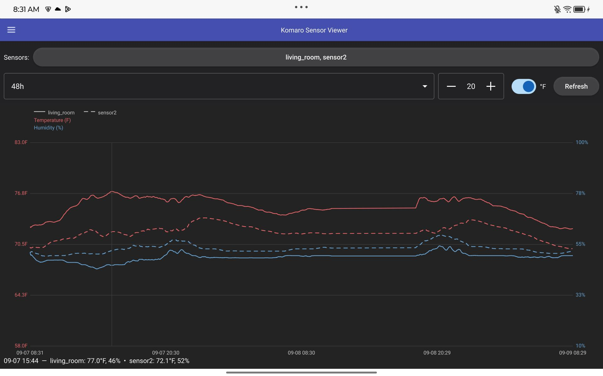

# Qt/QML based apps

A QML app to display temperature/humidity plots from InfluxDB, targeting desktop and Android.
It is similar in purpose to the `nano/plot_sensor.py` / `nano/plot_multi_sensor.py` Python scripts.

## Layout

```
┌───────────┬──────────────────────────────────────────────────────────────────────────┐
│ Directory │ What it is                                                               │
├───────────┼──────────────────────────────────────────────────────────────────────────┤
│ core/     │ Static libs and the shared KomaroCore QML module; no UI shell of its own │
│ desktop/  │ MenuBar shell (komaro_qml_desktop)                                       │
│ mobile/   │ ToolBar+Drawer (Material Dark) shell; desktop prototype or Android APK   │
└───────────┴──────────────────────────────────────────────────────────────────────────┘
```

Other files: `KB.md` (Qt/QML topics and gotchas), `TODO.md` (what is outstanding),
`screenshots/`.

## Status

### Desktop (`desktop/`)

A Qt Quick `ApplicationWindow` with `File`/`Help` menus and a chart below the menu bar.

- `desktop/qml/Main.qml` is a thin shell: it arranges the shared actions (Connect, About, Exit)
  from `core/qml/AppActions.qml` into a `MenuBar`.
- Connect works end-to-end. An editable history combo box records the selected host. It is backed
  by `core/`'s `ConnectionManager` and persisted via `QSettings`.
- A controls row (sensors, time range, moving-average window) drives `core/`'s `ChartController`.
  It queries InfluxDB and feeds the result into the chart.
- The chart is `core/qml/SensorChart.qml`: a hand-rolled `Canvas` dual-axis
  (temperature/humidity) line chart, shared with the mobile shell. It mirrors
  `nano/plot_sensor.py`.
- The sensor picker (`core/qml/MultiMeasurementSelect.qml`, also shared) can select several
  measurements at once. Each is overlaid as its own temperature/humidity line pair, distinguished
  by dash style and marker shape. This mirrors `nano/plot_multi_sensor.py`.

### Mobile (`mobile/`)

The second shell for the same shared `AppActions`: a `ToolBar`+`Drawer` presentation instead of a
`MenuBar`. It builds two ways:

- as a desktop app, for quick UI iteration;
- as a real Android `.apk` (Qt 6.8.3 `android_arm64_v8a` kit + NDK r26b).

See `mobile/README.md` for the Android toolchain setup and `TODO.md` for what is still
outstanding (on-device testing).

## Screenshots

Desktop (`MenuBar` shell):



Mobile (`ToolBar`+`Drawer` shell, run in desktop mode):



Mobile, running as a real Android APK on a Lenovo Tab M11. It shows a live 48h chart (1103
points) queried from InfluxDB on-device, with the °F units toggle enabled:



## Backend

Starting with a C++ backend (native Qt Quick app, CMake + Qt for Android). Other backends (e.g.
PySide6/Python, reusing the existing `nano/` InfluxDB query code) may be added later.

## Desktop build

`desktop/CMakeLists.txt` pulls in `../core` via `add_subdirectory` and links it into the app.
Presets are in `desktop/CMakePresets.json`.

### Windows

Qt 6.8.3 (LTS) is installed at `E:\qt6\6.8.3\msvc2022_64` and used via `CMAKE_PREFIX_PATH`. Use
the CMake bundled with Visual Studio 2022:

```
cd qml/desktop
cmake --preset windows-msvc
cmake --build --preset windows-msvc-debug
ctest --preset windows-msvc-debug
```

- Executables land in `build/windows-msvc/bin/<Config>/`, libraries in
  `build/windows-msvc/lib/<Config>/`.
- `windeployqt` runs automatically after a successful build, so `komaro_qml_desktop.exe` is
  self-contained.

### Linux

Same steps with the Linux preset for your machine (`linux-rpi` on the Raspberry Pi dev box,
`linux-ubuntu` elsewhere):

```
cd qml/desktop
cmake --preset linux-rpi
cmake --build --preset linux-rpi-debug
ctest --preset linux-rpi-debug
```

The `windeployqt` post-build step does nothing on Linux.

### Tests and vcpkg

- Tests are gated by the `BUILD_TESTS` cache variable (default `ON`). Pass `-DBUILD_TESTS=OFF` to
  skip them.
- `desktop/vcpkg.json` (vcpkg at `G:\opt\vcpkg`) only pulls in `gtest`, which `core`'s tests need.
  It is not wired into `CMAKE_PREFIX_PATH`, so Qt itself is not built via vcpkg.

### Install

```
cmake --install build/<preset> --prefix <dir>
```

This produces a redistributable copy of `komaro_qml_desktop` in `<dir>`, with Qt's runtime
dependencies deployed into the install tree. It uses `windeployqt` on Windows and Qt's generic
deploy tool on Linux.

On Linux:

- The real binary installs to `libexec/`. `bin/komaro_qml_desktop` is a thin wrapper script that
  sets `LD_LIBRARY_PATH` and then execs it. See `KB.md` for why that is necessary.
- The default install prefix on the `linux-ubuntu` preset is `$HOME/.local`. Run
  `cmake --install build/linux-ubuntu` with no `--prefix` to install there.

### Desktop integration (Linux)

The install also registers the app with the desktop environment:

```
┌──────────────────────────────────┬────────────────────────────────────┐
│ Source                           │ Installed to                       │
├──────────────────────────────────┼────────────────────────────────────┤
│ desktop/komaro-desktop.desktop   │ share/applications/                │
│ desktop/icons/komaro-desktop.svg │ share/icons/hicolor/scalable/apps/ │
└──────────────────────────────────┴────────────────────────────────────┘
```

The `.desktop` file is a standard freedesktop.org menu entry. The icon is a small dual-line chart
in the app's own temperature/humidity colors. Once installed under `$XDG_DATA_HOME`
(`~/.local/share` by default, which the default `$HOME/.local` prefix already is), the app shows
up with its icon in GNOME's "Show Applications" grid and the equivalents in other desktop
environments.
